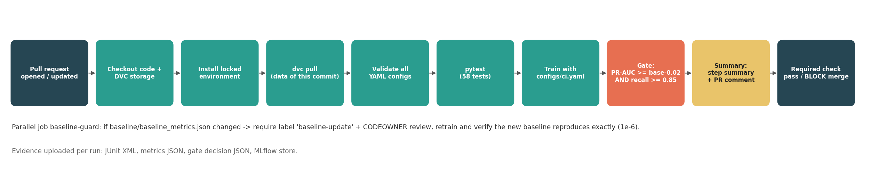

# Task 6: Automated quality gate (CI/CD)



## Workflow

[`.github/workflows/quality-gate.yml`](../.github/workflows/quality-gate.yml) runs on **every pull request to `main`** (and on pushes to `main`, to confirm the merged state). The job `quality-gate`:

1. Checks out the PR and the DVC storage branch, installs `requirements.lock`, and runs `dvc pull` for the exact data version the PR points to.
2. Validates every YAML config.
3. Runs **pytest** (JUnit XML kept as evidence).
4. **Trains with `configs/ci.yaml`** and writes `reports/metrics/ci_metrics.json`. The run is also tracked in a CI-local MLflow store and uploaded as an artefact.
5. **Compares with the baseline stored in the repository** (`baseline/baseline_metrics.json`) using the configured rule:
   `PR-AUC ≥ baseline − 0.02 AND recall ≥ 0.85` (chosen in Task 8; see [memo](gate_defense_memo.md)), plus a CI time budget (`gate.max_minutes: 10`).
6. **Publishes a run summary** (a Markdown table of checks, a metric-by-metric baseline vs PR comparison with deltas, failing test names, and a provenance block with commit, data version and config hash) to the **job summary page** and as a **PR comment**, so reviewers do not need the logs.
7. The final step fails the job if tests failed, training failed, or the gate failed. Because `quality-gate` is a **required status check**, GitHub then **blocks the merge**.

Steps 3–5 use `continue-on-error` so that the summary is *always* produced; enforcement happens in step 7.

Runtime: the CI training step takes ≈5–6 s (laptop) for 10 settings × 5 folds plus threshold tuning. The whole job, including dependency install (cached), takes a few minutes; see the Actions history for exact durations.

## Required pull-request scenarios

| PR | Change | Expected | Gate result |
|---|---|---|---|
| PR 1 (pass) | `feat(config)`: wider C grid for logistic regression | pass | see [`reports/ci/pr_history.md`](../reports/ci/pr_history.md) |
| PR 2 (fail: model worse) | `refactor(features)`: drop the payment-delay features "to simplify" | blocked: PR-AUC drop beyond tolerance | ″ |
| PR 3 (fail: test) | `fix(features)`: treat a zero credit limit as zero utilisation | blocked: unit test `test_ratio_zero_limit_with_balance_is_capped` fails | ″ |
| PR 4 (data drill) | `data`: dataset v2 enters via DVC | gate runs on new data; decision in [drill](data_change_drill.md) | ″ |
| PR 5 (baseline) | `baseline`: adopt v2 baseline (label `baseline-update`) | baseline-guard verifies reproducibility | ″ |

## Baseline update rule (and how it is protected)

**Rule.** The baseline is the CI-config result of the code + config + data currently on `main`. It may change **only** when *all* of the following hold:

1. It is produced by `python scripts/update_baseline.py --reason "<why>"` from a **clean working tree**. The script refuses a dirty tree, retrains, and records the reason, timestamp, git commit, data md5/version, config hash, MLflow run id, and the previous baseline.
2. The change is in **its own PR**, labelled **`baseline-update`**, with a reason that links the evidence (for a data change: the multi-seed drill).
3. A **CODEOWNER** approves (`.github/CODEOWNERS` covers `baseline/`, gate config and workflows).
4. The PR passes **`baseline-guard`**, which retrains on the PR's code and data and fails unless the committed numbers reproduce **exactly** (1e-6), with matching data md5 and config hash.
5. A baseline may go **down** only for an explained reason, such as a harder or larger test set after a data change. It is never lowered to let an unrelated PR pass.

**Protection against accidental changes.**

| Threat | Protection |
|---|---|
| A PR silently edits the baseline (e.g. lowers it so a worse model passes) | `baseline-guard` fails without the `baseline-update` label, and fails even with the label if the numbers do not reproduce |
| A hand-edited or typo'd baseline | Exact reproducibility check, plus a "do not edit" header in the file |
| An unreviewed change to the gate threshold or workflow | CODEOWNERS + "require review from Code Owners" |
| Gradual drift (many small accepted drops) | Each PR is compared with the **fixed** baseline, not with the previous PR, so tolerance does not compound |
| Gate bypassed by a direct push to main | Branch protection: `quality-gate` and `baseline-guard` required, branch must be up to date, **enforced for admins too**, no force-push or deletion |

### Branch protection (one-time setup, free on public repos)

```bash
gh api -X PUT repos/<owner>/<repo>/branches/main/protection --input - <<'JSON'
{"required_status_checks":{"strict":true,"contexts":["quality-gate","baseline-guard"]},
 "enforce_admins":true,"required_pull_request_reviews":null,
 "restrictions":null,"allow_force_pushes":false,"allow_deletions":false}
JSON
gh label create baseline-update --color B60205 --description "PR intentionally changes the quality-gate baseline"
```

For a team, set `"required_pull_request_reviews": {"require_code_owner_reviews": true, "required_approving_review_count": 1}`. GitHub does not let authors approve their own PRs, so a single-maintainer repository relies on the required checks plus the `baseline-update` label rule.

## Reading the summary

The gate posts a table like this (real local run on v1):

```text
## ✅ Model quality gate: PASSED, merge allowed
| Check | Result | Detail |
| Unit tests | ✅ | 58 tests, 0 failures, 0 errors |
| average_precision vs baseline | ✅ | 0.8762 vs 0.8762 (delta +0.0000, allowed -0.02) |
| recall floor | ✅ | 0.9706 vs floor 0.85 |
| CI time budget | ✅ | training 5s (budget 10 min) |
```

followed by per-metric deltas and a collapsible provenance table. When the data version differs from the baseline's, the summary adds a warning pointing to the drill procedure.

## Run locally

```bash
make gate     # tests + CI training + comparison, writes reports/ci/gate_summary.md
```
