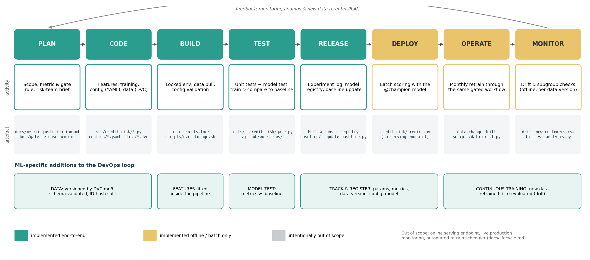
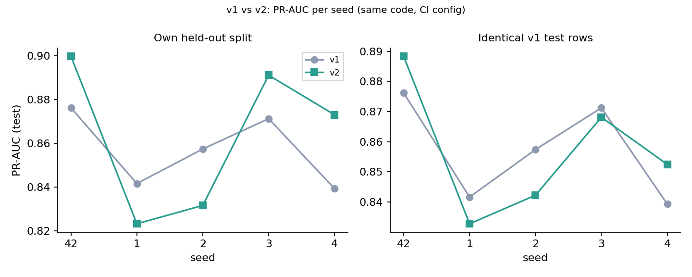

# Credit Risk Model with a CI/CD Quality Gate

MLOps (Elective II), Project 1 · Team: Nikhil &amp; Harsh · Syllabus topics 1, 2, 4, 10, 11, 12 · All results reproducible with <code>make setup data reproduce</code>; every number below is traceable to a tracked MLflow run (IDs in <code>reports/</code>).

## 1. Problem and what we built

An untested change lowered a monthly credit-default model's quality for two weeks, and nobody could say which code, configuration or data produced it. We built a workflow in which **every change is versioned (Git + DVC), validated (Pydantic configs, data contract), tested (58 pytest tests), tracked (MLflow, 38 runs) and accepted only if a retrained model is not worse than a protected baseline (GitHub Actions gate)**. We also chose the gate rule by replaying eight candidate rules against our own run history.

The figure maps every DevOps stage to a repository artefact (details: `docs/lifecycle.md`). Serving, live monitoring and a retrain scheduler are left out on purpose: the bank scores in batch, retrains monthly through a reviewed data PR, and has no live labels in this project. ML delivery differs from software delivery in five ways we had to design for:

- behaviour depends on data as well as code;
- passing tests does not mean a good model (dropping the delay features passed every test but lost 0.093 PR-AUC);
- metrics are noisy, so tolerances must be measured;
- the release unit is a trained pipeline plus its threshold, which needs lineage;
- quality decays as populations drift.

## 2. Design decisions

**Versioning (Task 2).**

- Git holds code, configuration and a DVC pointer (`data/raw/credit_card_customers.csv.dvc`); the CSV is never in Git history.
- The DVC remote is content-addressed storage on an orphan branch, `dvc-storage`, which CI reads with the built-in token. This is free, has no secrets, and works from a fresh clone. It can be swapped for S3 with one command.
- `data/versions.yaml` maps md5 → `v1`/`v2`. Tags mark restore points.
- `scripts/restore_demo.sh` clones tag `baseline-v1` into a temporary directory, pulls its data and retrains. It reproduces the recorded PR-AUC **0.876207** and recall **0.970588** exactly.
- Version 2 entered through PR "data: dataset v2" as a two-line pointer diff.

**Configuration (Task 3).**

- `base.yaml` holds every tunable value: paths, utilisation cut-off, delay flag, age bins, imputation, search spaces, seed, tracking, gate.
- `dev`, `ci` and `full` extend it.
- A strict Pydantic schema rejects unknown keys (a typo such as `utilization_…` fails immediately), wrong types, out-of-range values and inconsistent bins, listing every offending field (exit code 2).
- Each run logs the resolved config as an artefact plus its SHA-256, so the configuration of any result is recoverable.

**Cleaning and features (Task 4).**

- The missing values in `Credit_Limit`, `Current_Balance` and `Payment_Delay_Days` occur in the **same 24 rows** with a normal default rate. We impute training-set medians inside the pipeline and add a `record_incomplete` flag.
- Engineered features:
    - `utilisation` (ratio; largest coefficient);
    - `spend_to_limit` and `spend_per_transaction`;
    - `high_utilisation_flag` (≥ 0.80, configurable) and `late_payer_flag` (> 7 days);
    - `age_band` (binned, one-hot; captures a non-linear age effect);
    - our own `credit_stress_index` = utilisation × log(1 + delay), for compounding stress.
- Edge cases are defined and tested: a zero or negative credit limit gives the capped ratio, and zero transactions are clipped.
- Leakage is prevented by construction: the target is rejected by the builder, `Customer_ID` is ignored (tested invariance), and all statistics are fitted per fold.
- The whole pipeline is one scikit-learn object, so training, CI and `predict.py` are identical.
- Ablations: engineered features add +0.079 CV PR-AUC, mostly through the ratios. **Our own feature adds no measurable lift (+0.002 when removed, inside the 0.04 fold sd)**. We report this rather than overclaim.

**Training, metric and registry (Task 5).** 20% positives make accuracy misleading. Predicting "nobody defaults" scores **81.7%** accuracy on our test split, *higher* than our model's 81.2%, while catching 0 of 34 defaulters (we catch 33). We therefore:

- select models by **cross-validated PR-AUC on the training split**;
- set the decision threshold by maximising **F2** on out-of-fold scores, because missed defaulters cost more than reviews;
- report recall, precision, ROC-AUC and Brier score.

| Model | CV PR-AUC ± sd | Test PR-AUC | Test recall | Test precision |
|---|---|---|---|---|
| Dummy (prior) | 0.191 ± 0.004 | 0.183 | 1.000 | 0.183 |
| Logistic regression (C = 1) | 0.866 ± 0.036 | 0.884 | 0.971 | 0.635 |
| **Logistic regression, tuned (selected)** | **0.873 ± 0.040** | 0.876 | 0.971 | 0.493 |
| Random forest, tuned (48 settings) | 0.852 ± 0.053 | 0.788 | 0.824 | 0.596 |
| Gradient boosting, tuned (48 settings) | 0.852 ± 0.051 | 0.781 | 0.853 | 0.580 |

The tree ensembles overfit 600 training rows. The selected run is registered as `credit-risk-classifier` v1 (alias `@champion`), with tags for git commit, `git_dirty=false`, data md5/version, config name/hash and seed. Logged models bundle their source code and pinned requirements.

**Quality gate (Task 6).** On every PR the workflow:

1. pulls the PR's data version;
2. validates the configs and runs pytest;
3. trains `ci.yaml` (≈5 s);
4. compares with `baseline/baseline_metrics.json`;
5. publishes a Markdown summary (checks, metric deltas, failing tests, provenance) to the job page and as a PR comment;
6. fails the required check to block the merge.

The baseline can change only through `scripts/update_baseline.py` (clean tree, mandatory reason) in a PR labelled `baseline-update`. There, a `baseline-guard` job retrains and requires an exact (1e-6) match, so a hand-lowered baseline cannot merge. CODEOWNERS and branch protection cover the rest. The CI history shows three PRs:

- PR 1 passes (wider C grid);
- PR 2 is blocked because the model is worse (delay features dropped);
- PR 3 is blocked by the failing test `test_ratio_zero_limit_with_balance_is_capped`.

## 3. Choosing and defending the gate (Task 8)

We built a labelled history of 18 CI runs: five benign changes, seven harmful changes, and five seed changes as noise probes. Against it we replayed eight rules:

| Rule | Benign accepted | Harmful rejected | Lets through |
|---|---|---|---|
| R1 accuracy ≥ baseline | 5/5 | 2/7 | 5 harmful, incl. recall falling to 0.62 |
| R3 PR-AUC ≥ baseline (strict) | 3/5 | 5/7 | threshold regressions; blocks 2 refactors |
| R4 PR-AUC ≥ baseline − 0.02 | 5/5 | 5/7 | threshold-0.5 and threshold-0.7 (PR-AUC unchanged) |
| R6 F2 ≥ baseline − 0.02 | 5/5 | 6/7 | raw-features-only (−0.060 PR-AUC) |
| R7 R4 + recall ≥ 0.70 | 5/5 | 6/7 | threshold-0.5 (recall 0.765) |
| **R8 R4 + recall ≥ 0.85 (adopted)** | **5/5** | **7/7** | — |

Benign changes on the fixed split moved PR-AUC by ≤ 0.0095, and the smallest real regression was 0.060. The 0.02 tolerance therefore sits 2× above jitter and 3× below harm.

The trade-offs we accept:

- up to 0.02 of real PR-AUC loss can pass, though it cannot compound because the baseline is fixed;
- the recall floor is coarse (one test defaulter = 2.9 points), so changes that move the split itself need the multi-seed drill.

The one-page memo (`docs/gate_defense_memo.md`) states what evidence would change the rule: cost data, a larger pooled test set, or benign shifts above 0.02.

**Fairness.** Out-of-fold over 800 customers, the High-income group has fewer false flags (FPR 12.4% vs 17.3–17.6%) but more missed defaulters (FNR 9.5% vs 3.0–6.3%). The test-split view rests on only 5 High-income defaulters. All intervals overlap, and retraining without `Income_Bracket` leaves PR-AUC (0.878) and the gaps unchanged. The disparity is therefore not caused by the income input: it follows the behavioural features and the groups' base rates (12.7% vs 20–21%). We judge it **acceptable**, re-check it on every data version, set a 10-point gap with a CI excluding 0 as the trigger to act, and propose dropping the uninformative income feature in a future PR.

## 4. Data-change drill: v1 versus v2 (Task 7)

Dataset v2 (v1 plus 300 new customers) went through the same CI configuration. Both versions were pulled from history with `dvc get --rev` and trained with **five seeds** each: 10 tracked runs tagged `data_version` and `data_md5`. Because the split hashes `(seed, Customer_ID)`, every v1 customer sits on the same side in both versions, which allows a paired comparison on identical rows.

| v2 − v1 (PR-AUC) | Mean | SD (seeds) | v2 better | p (paired t) |
|---|---|---|---|---|
| Own test split (what CI sees) | +0.0066 | 0.0268 | 3/5 | 0.61 |
| Identical v1 test customers | −0.0004 | 0.0126 | 2/5 | 0.95 |
| New-customer test rows | +0.0083 | 0.0056 | 5/5 | 0.03 |
| Recall, own split | −0.0351 | 0.0556 | 1/5 | 0.23 |

**Findings.**

- On the gate's seed, v2 scores PR-AUC 0.8997 against the baseline's 0.8762 (+0.0235), and the gate passes it.
- That apparent gain is not real. Over seeds it is +0.007 ± 0.027, the same size as pure seed noise (sd 0.025). On identical customers the models are indistinguishable, and every seed's paired-bootstrap 95% interval contains 0.
- Most of the +0.0235 comes from a different, easier test set: the v1 model already reaches 0.93 on the new customers.
- The only consistent gain is small and expected (+0.008 on new customers).
- Drift is minor: the new customers are slightly older (KS p = 0.007, PSI 0.095) and identical on financial features and default rate.

**Conclusion: the gate should accept the v2 model as "not worse", not as "better".** It is equivalent on known customers, slightly better on the new segment, trained on 37.5% more and fresher data, and representative of the current population. We merge it and move the baseline in a separate `baseline-update` PR whose reason cites this drill, without claiming a +0.024 improvement. Recall at the F2-tuned threshold fell below 0.85 for two of five seeds, so the next data month is the first place to watch.

## 5. Limitations and next steps

- Small test sets: 34–64 defaulters per split limit how precise recall and subgroup estimates can be. Pooling months would allow a tighter tolerance and a relative recall guard.
- Cost-based gating needs real cost-of-error figures from the risk team.
- Out of scope but straightforward with the same artefacts: a scheduled retrain trigger (`on: schedule`), a REST endpoint serving `@champion`, and live drift and subgroup dashboards.
