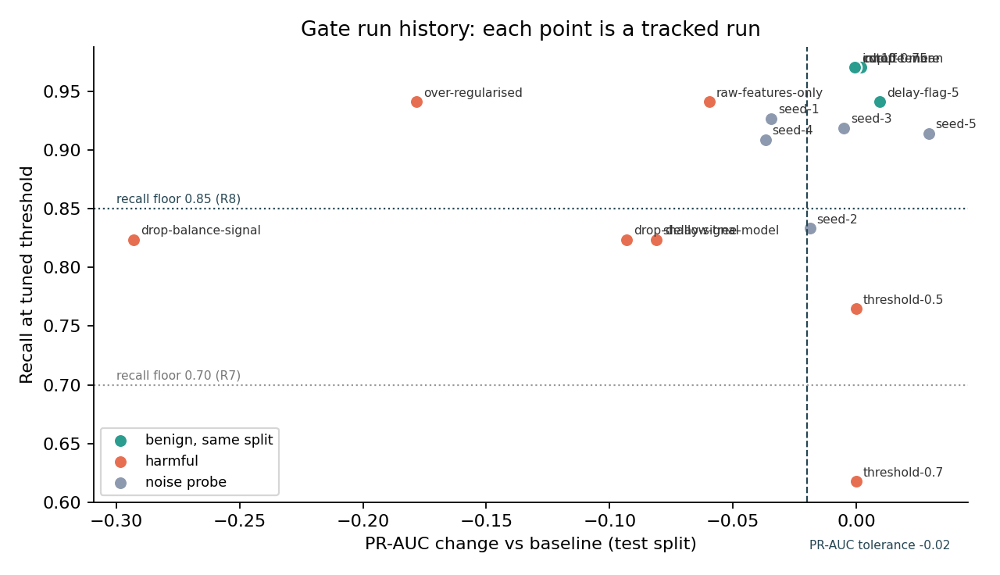
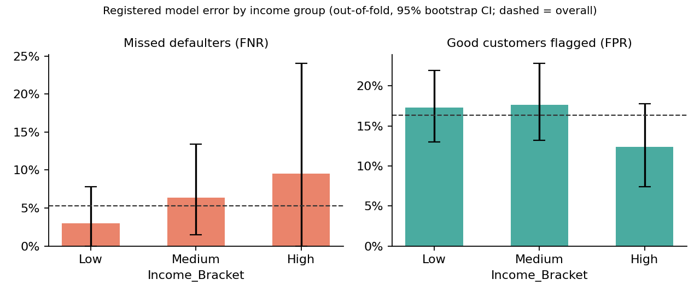

# Task 8: Gate-rule comparison and subgroup (fairness) analysis

## A. Candidate gate rules against our own run history

**Run history.** 18 tracked CI-config runs (`credit-risk-ci`, `run_label = gate-history/*`), each simulating a pull request whose effect we know:

- **Reference (1):** the baseline reproduction, PR-AUC 0.8762, recall 0.9706.
- **Benign, same split (5):** cut-off 0.80→0.75, late flag 7→5 days, median→mean imputation, 10-fold CV, drop `Tenure_Months`.
- **Harmful (7):** delay features lost, balance features lost, C = 0.0005 typo, threshold reset to 0.5 or 0.7, feature engineering disabled, model swapped for a tiny forest.
- **Noise probes (5):** seed changes, which move the test split itself.

Generated by [`scripts/gate_rule_analysis.py`](../scripts/gate_rule_analysis.py); per-run decisions with run IDs are in [`reports/gate/gate_decisions.csv`](../reports/gate/gate_decisions.csv).

| Rule | Benign accepted | Harmful rejected | False blocks | False accepts | Harmful it lets through | Noise probes accepted |
|---|---|---|---|---|---|---|
| R1 accuracy ≥ baseline | 5/5 | 2/7 | 0 | **5** | delay-signal, raw-features, tiny-forest, threshold-0.5, threshold-0.7 | 5/5 |
| R2 ROC-AUC ≥ baseline − 0.01 | 5/5 | 5/7 | 0 | 2 | threshold-0.5, threshold-0.7 | 2/5 |
| R3 PR-AUC ≥ baseline (strict) | **3/5** | 5/7 | **2** | 2 | threshold-0.5, threshold-0.7 | 1/5 |
| R4 PR-AUC ≥ baseline − 0.02 | 5/5 | 5/7 | 0 | 2 | threshold-0.5, threshold-0.7 | 3/5 |
| R5 PR-AUC ≥ baseline − 0.05 | 5/5 | 5/7 | 0 | 2 | threshold-0.5, threshold-0.7 | 5/5 |
| R6 F2 ≥ baseline − 0.02 | 5/5 | 6/7 | 0 | 1 | raw-features-only | 4/5 |
| R7 PR-AUC ≥ b − 0.02 AND recall ≥ 0.70 | 5/5 | 6/7 | 0 | 1 | threshold-0.5 (recall 0.765) | 3/5 |
| **R8 PR-AUC ≥ b − 0.02 AND recall ≥ 0.85** | **5/5** | **7/7** | **0** | **0** | — | 2/5 |

**Noise scale behind the tolerance.**

- Benign changes evaluated on the same split move PR-AUC by at most **0.0095**.
- The smallest PR-AUC drop of a harmful change that moves PR-AUC at all is **0.0597**.
- A pure seed change moves test PR-AUC with **sd 0.0248**.

So 0.02 sits about 2× above benign jitter and 3× below the smallest real regression. R3 (no tolerance) blocks harmless refactors such as `impute-mean` (−0.0006). R5 (0.05) is too close to real regressions. Threshold-only regressions leave PR-AUC exactly unchanged (the ranking is identical), so **any ranking metric alone (R2–R5) is blind to them**, which is why a recall guard is needed.

## B. Subgroup error of the registered model by `Income_Bracket`

Model `models:/credit-risk-classifier@champion` (version 1, logistic regression, data v1), threshold 0.1326. Generated by [`scripts/fairness_analysis.py`](../scripts/fairness_analysis.py) → [`reports/fairness/subgroup_breakdown.md`](../reports/fairness/subgroup_breakdown.md). FNR = defaulters missed; FPR = good customers wrongly flagged. 95% bootstrap intervals (2,000 resamples).

**Registered model on its held-out test split (186 customers)**

| Income | n | defaulters | base rate | flagged | error rate | FNR [95% CI] | FPR [95% CI] | precision |
|---|---|---|---|---|---|---|---|---|
| Low | 77 | 12 | 15.6% | 35.1% | 19.5% | 0.0% [0, 0] | 23.1% [13, 34] | 0.44 |
| Medium | 68 | 17 | 25.0% | 39.7% | 14.7% | 0.0% [0, 0] | 19.6% [9, 31] | 0.63 |
| High | 41 | 5 | 12.2% | 31.7% | 24.4% | 20.0% [0, 67] | 25.0% [11, 39] | 0.31 |
| All | 186 | 34 | 18.3% | 36.0% | 18.8% | 2.9% [0, 10] | 22.4% [16, 29] | 0.49 |

**Same pipeline and hyperparameters, out-of-fold over all 800 customers** (more defaulters per group, so tighter intervals)

| Income | n | defaulters | base rate | flagged | error rate | FNR [95% CI] | FPR [95% CI] | precision |
|---|---|---|---|---|---|---|---|---|
| Low | 333 | 67 | 20.1% | 33.3% | 14.4% | 3.0% [0, 8] | 17.3% [13, 22] | 0.59 |
| Medium | 301 | 63 | 20.9% | 33.6% | 15.3% | 6.3% [1, 13] | 17.6% [13, 23] | 0.58 |
| High | 166 | 21 | 12.7% | 22.3% | 12.0% | 9.5% [0, 24] | 12.4% [7, 18] | 0.51 |
| All | 800 | 151 | 18.9% | 31.1% | 14.2% | 5.3% [2, 9] | 16.3% [14, 19] | 0.57 |

**Reading.**

- Error is *not* perfectly even: the High-income group has a **lower false-alarm rate** (12.4% vs ≈17.5%) but a **higher miss rate** (9.5% vs 3.0–6.3%).
- The gaps (FPR 5.2 points, FNR 6.5 points) are inside overlapping confidence intervals. The High group has only 21 defaulters, so one missed defaulter moves its FNR by 4.8 points.
- On the test split alone, High-income FNR rests on 1 missed defaulter out of 5.
- The FPR pattern follows the base rates: Low and Medium customers default more often (20–21% vs 12.7%), and a single threshold flags more of them.

**Counterfactual.** Retraining *without* `Income_Bracket` as an input gives the same overall PR-AUC (0.878 vs 0.877) and the same group gaps (High FPR 11.7%, FNR 9.5%). So the disparity is not caused by the model using income directly; it comes from the behavioural features (utilisation, delay) and the groups' different base rates.

**Decision.** The disparity is **acceptable for release**: it is small, not statistically distinguishable from zero with this sample, and not driven by the income feature. The direction that matters most for customers, being wrongly flagged, is *less* frequent for the group with lower measured risk and similar between Low and Medium. Conditions attached:

1. Re-run the breakdown on every new data version (it is one command).
2. Revisit if any group's FNR or FPR gap exceeds **10 points with a CI that excludes 0**.
3. Because `Income_Bracket` adds no predictive value, the next modelling PR should consider dropping it (fairness through unawareness at zero cost), with the gate verifying "not worse".
